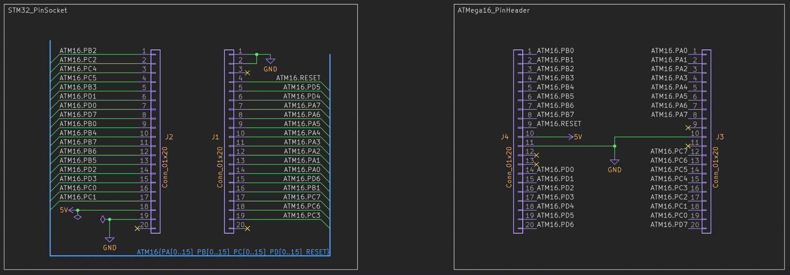
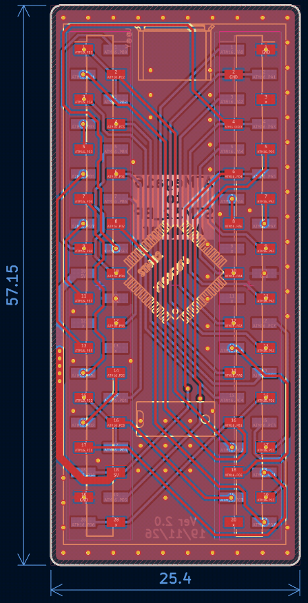

# ATmega16–STM32 Breakout / Adapter

A pinout adapter board that maps an **STM32 Blue Pill (STM32F103C8T6)** to the **ATmega16 PDIP-40** pin arrangement.

The board allows an STM32 Blue Pill to interface with existing hardware designed around an ATmega16 PDIP-40 socket, such as an ATmega16 trainer board.

## Schematic

## PCB Layout

## Board Dimensions

|            |                 |
|------------|-----------------|
| **Width**  | $25.40\ mm$     |
| **Height** | $57.15\ mm$     |
| **Area**   | $1450.751\ mm^2$|

## Manufacturing Files

Gerber files and drill data are available in the [`Gerber/`](gerber/) directory.

---

*Designed with KiCad.*

