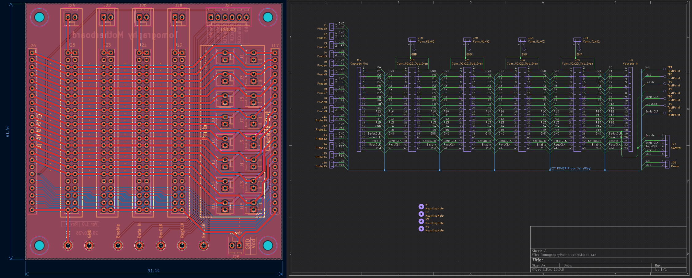
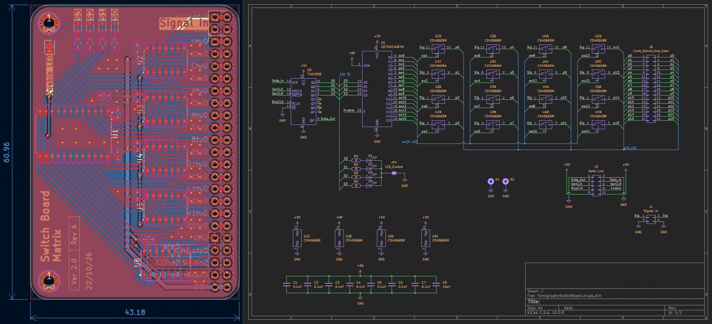

# Tomography Swith Board Matrix

> ## Motherboard-Daughterboard Architecture

---

### [Motherboard](./TomographyMotherboard)

**Dimension:** $91.44mm \times 91.44mm$

**Area:** $8361.274mm^2$

### [Daughterboard](/TomographySwitchBoard)

**Dimension:** $43.18mm \times 60.96mm$

**Area:** $2619.788mm^2$

